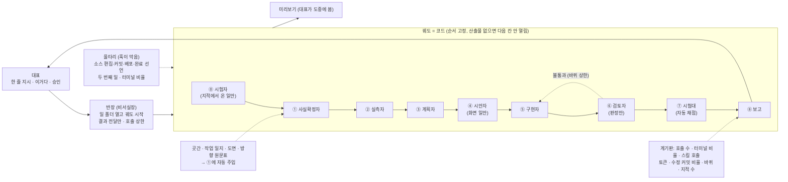
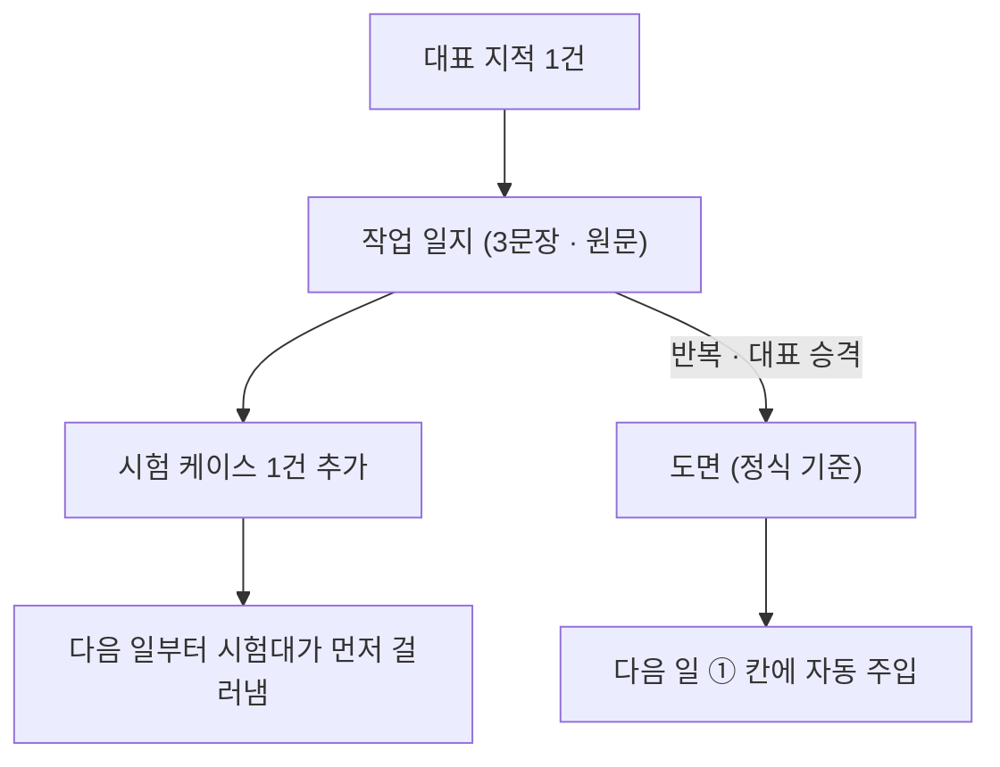

# IF 공방 v2 — 절차가 코드가 되고, AI는 한 칸만 맡는다

v1은 부품 9개와 다듬질 고리를 정했다(`concept.md`). v2는 그 위에 한 가지를 더 고정한다:
**절차를 지시문으로 두지 않고 장치로 만든다.** 반장(메인 에이전트)이 절차를 수행하는 주체에서
내려오고, 절차는 코드로 정해진 궤도가 되며, AI 직원들은 궤도의 한 칸씩만 맡는다.

v2가 약속하는 것은 오류 0이 아니라 **오류의 재발 0**이다. 처음 보는 오류는 사람 눈이 아니라
미리보기·검토자·시험대에서 걸리고, 그 지적이 시험 케이스가 되어 두 번째는 없다.

## 읽는 순서 (파일을 작게 나눴다 — 각각 따로 읽어도 된다)

| 파일 | 내용 |
|---|---|
| `v2.md` (이 파일) | 왜 장치인가 · 구조 그림 · 궤도 9칸 표 |
| `v2-staff.md` | 부품 9개 v1→v2 · AI 직원 7명 · 스킬이 알아서 붙는 방식 |
| `v2-quality.md` | 시험대 · 화면 일의 궤도 · 계기판 |
| `v2-devices.md` | 어떻게 막는가: 자기신고를 믿지 않는 검사 · 보호 파일 · 케이스 관리 · 막는 훅 목록 |
| `v2-rollout.md` | 모든 개발에 거는 법 · 한계 → 돌파 · AI 사무실 · 저장소 상태 · 출처 |

## 왜 장치인가

AI 에이전트에게 글로 적은 규칙("이 단계에서는 이 스킬을 쓴다")은 에이전트가 스스로 기억하고 선택해야
작동한다. 문맥이 커지고 일이 급해지면 선택은 습관(터미널 명령으로 직접 처리)으로 돌아가고, 안내만
하는 훅은 무시된다. 반면 **막는** 훅(승인 관문, 위험 명령 차단)은 지켜진다. v2는 그 차이 위에
서 있다. 지켜야 할 것은 지킬 필요가 없게(주입·화이트리스트·순서 고정) 만들고, 산출물이 없으면 다음
행동을 막는다.

## 구조 한눈에

## 궤도 8칸

일 하나 = 폴더 하나 = 대화창 하나. 산출물은 전부 그 폴더의 파일이고, 다음 칸은 **코드가 파일을
검사해서** 연다. 모델이 순서를 정하지 않는다.

| 칸 | 맡는 직원 | 받는 것 | 내는 것(파일) | 도구 화이트리스트 | 다음 칸이 열리는 조건 |
|---|---|---|---|---|---|
| ⓪ 시험 등록 (지적에서 시작한 일만) | 시험자 | 대표 지적(작업 일지) | `tests/bench/`에 케이스 + **현재 코드에서 실패한 실행 기록** | 읽기, 쓰기(`tests/bench/`만), 터미널(샌드박스) | 실패 기록이 있어야 ①로. 이 칸도 칸 끝 해시 비교를 받는다 |
| ① 사실확정 | 사실확정자 | 지시 한 줄 + 자동 주입(곳간 검색 결과·그 프로젝트 작업 일지·도면·방향 원문표) | `facts.md` — 주장별 통과/확인 필요/탈락 + 출처. 「코드에 넣는 값」표는 `키 | 값 | 판정 | 출처` 고정 형식, 키는 `<대상>.<필드>` | 읽기, 검색, 곳간, 웹 문서 읽기, 스킬, **쓰기는 `facts.md` 한 파일만**. 터미널 없음 | 「코드에 넣는 값」표에 「확인 필요」가 0개 **이고 「통과」 줄마다 출처가 있을 것**(출처 없는 통과는 막힘). ② 실측 응답과 값이 다르면 되돌아옴 |
| ② 실측 | 실측자 | facts.md의 외부 대상 목록 | `probe/<대상>.log` — 공식 문서 주소, 실제 호출 1회(**조회·테스트 모드만**), 성공 표시, 실제 요청·응답 형식, 그리고 `{"<대상>.<필드>": 값}` 블록 — facts.md와 **같은 키**로 스크립트가 대조 | 읽기, 쓰기(probe/만), 터미널, 웹 문서 읽기 | 대상마다 성공 표시. 쓰기 성격(게시·발송·결제·삭제) 호출은 승인 관문 + 테스트 계정 없이는 차단 |
| ③ 계획 | 계획자 | facts·probe | `plan.md`(통과 장면: 사람이 하는 일 → 앱이 보여 주는 결과 → 화면 위치 → **그 장면을 돌리는 명령 한 줄**, 예외 장면, 파일 소유), `tools.md`(이 일의 도구표) | 읽기, 검색, 스킬(계획·육칠·스킬 창고 검색), 곳간, **쓰기는 `plan.md`·`tools.md`만**. 터미널 없음 | plan.md + tools.md. 갈림길이면 육칠 채점표에 대표 선택 인용 |
| ④ 시안 | 시안자 | plan.md(화면 일만) | `design.md` — 분위기 한 문장·서체 2·색 2·그리드·**참고 제품 캡처**·구조 옮김표·시안 링크·**대표 "이거다" 원문** | 읽기, 쓰기, 스킬(아우라 파밍·레이아웃), 브라우저, 시안 도구 | "이거다" 인용이 있어야 ⑤ 열림 |
| ⑤ 구현 | 구현자(파일 소유별로 여러 명 동시) | plan·facts·probe·design | 커밋(자기 파일만), plan.md에 적힌 통과 장면 명령의 실행 기록(**구현자가 명령을 고르지 않는다**), `coverage.md` 대조표 초안(자료·벤치마킹 항목별 들어감/일부/빠짐 + 파일:줄·캡처) | 읽기, 편집, 쓰기(**`tests/bench/` 차단**), 터미널(배포·DB·설치·push 차단), 스킬. **작업조 생성 없음** | 핵심 경로를 실제로 돌린 **실행 기록**이 있을 것(아래 "자기신고를 믿지 않는다") |
| ⑥ 검토 | 검토자 | 결과물·코드·통과 장면 | `review.md` — `판정: 통과/불통과`, 통과 장면 대조, **coverage.md의 "들어감"을 근거를 열어 하나씩 확인한 표**, 지적(번호·심각도·파일:줄·실패 장면), 화면이면 품질 판정표, 실제로 돌려 본 것 | 읽기, 검색, 브라우저, 터미널 — **일회용 작업 사본**(쓰기 허용, 칸 끝에 통째로 폐기)에서만. 원본 쪽 쓰기는 `review.md` 한 파일만 | 판정: 통과. 불통과면 ⑤로(바퀴 상한, 넘으면 멈추고 대표에게) |
| ⑦ 시험대 | 없음(스크립트) | 프로젝트의 `tests/bench/` | `bench.json` — pass/fail, 케이스별 점수, ⓪에서 등록한 케이스의 **고친 뒤 통과 기록** | — | pass:true. 인증·게시·삭제·외부 연동이면 다른 모델 계열 읽기 전용 점검 1회 추가 |
| ⑧ 보고 | 반장 | 위 전부 + 계기판 | `report.md` — ⑥이 확인한 대조표(⑤의 초안 중 검토자가 근거를 연 항목만 "들어감") · 화면 · 숫자 · 실측 · 미검증 · 도구표 대조 | — | 이 절들이 있고, 「실측」 절의 명령이 **훅의 실행 기록에 실제로 있어야** "완료"라는 말이 통과됨. 대조표는 ⑥ 확인본을 그대로 옮기며, ⑧에서 새로 "들어감"을 적을 수 없다 |

- **소형 궤도**(문구·버그 1개): ①②③을 한 파일로 줄이되 파일은 있어야 한다. 소형인지는 대표가 `/일`에서 고르고, 계획의 파일 수가 설정값을 넘거나 **민감 영역**을 건드리면 **코드가 전체 궤도로 자동 승격**하고 막는다 — AI가 고르지 않는다. 민감 영역은 계획자의 글이 아니라 설정 파일의 **대조 가능한 기준**으로 판정한다: 경로 패턴(`auth/`, `login`, `oauth`, `payment`, `billing`, `publish`, `deploy`, `migrations/`, `.env`, `settings`), 패키지 목록의 변화, 변경분에 새로 들어온 외부 호출 주소(127.0.0.1 밖의 `http(s)://`), 서비스·크론 명령. ⑦에서 다른 계열 점검을 붙일지도 같은 기준으로 코드가 정한다.
- **건너뛰기**는 대표만: `건너뛰기 <칸> <이유>` 한 줄이 상태에 남고 보고에 찍힌다.
- **멈출 조건:** 같은 지적이 두 바퀴 뒤에도 남음 / 가설 셋이 틀림 / 바퀴 상한 → 멈추고 "무엇을 해
  봤고 왜 멈췄는지" 보고한 뒤 범위를 줄인다.

