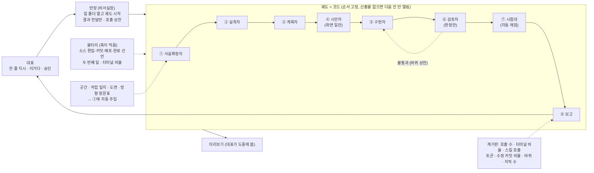
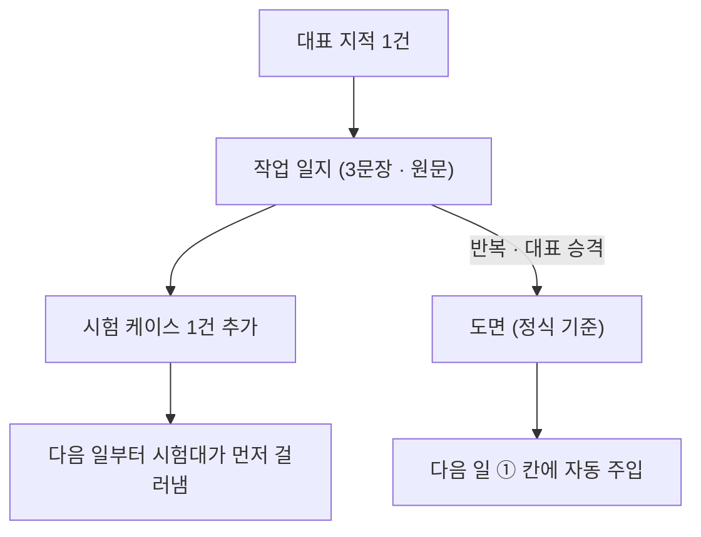

# IF 공방 v2 — 절차가 코드가 되고, AI는 한 칸만 맡는다

v1은 부품 9개와 다듬질 고리를 정했다(`concept.md`). v2는 그 위에 한 가지를 더 고정한다:
**절차를 지시문으로 두지 않고 장치로 만든다.** 반장(메인 에이전트)이 절차를 수행하는 주체에서
내려오고, 절차는 코드로 정해진 궤도가 되며, AI 직원들은 궤도의 한 칸씩만 맡는다.

v2가 약속하는 것은 오류 0이 아니라 **오류의 재발 0**이다. 처음 보는 오류는 사람 눈이 아니라
미리보기·검토자·시험대에서 걸리고, 그 지적이 시험 케이스가 되어 두 번째는 없다.

## 왜 장치인가

AI 에이전트에게 글로 적은 규칙("이 단계에서는 이 스킬을 쓴다")은 에이전트가 스스로 기억하고 선택해야
작동한다. 문맥이 커지고 일이 급해지면 선택은 습관(터미널 명령으로 직접 처리)으로 돌아가고, 안내만
하는 훅은 무시된다. 반면 **막는** 훅(승인 관문, 위험 명령 차단)은 지켜진다. v2는 그 차이 위에
서 있다. 지켜야 할 것은 지킬 필요가 없게(주입·화이트리스트·순서 고정) 만들고, 산출물이 없으면 다음
행동을 막는다.

## 구조 한눈에

## 궤도 8칸

일 하나 = 폴더 하나 = 대화창 하나. 산출물은 전부 그 폴더의 파일이고, 다음 칸은 **코드가 파일을
검사해서** 연다. 모델이 순서를 정하지 않는다.

| 칸 | 맡는 직원 | 받는 것 | 내는 것(파일) | 도구 화이트리스트 | 다음 칸이 열리는 조건 |
|---|---|---|---|---|---|
| ① 사실확정 | 사실확정자 | 지시 한 줄 + 자동 주입(곳간 검색 결과·그 프로젝트 작업 일지·도면·방향 원문표) | `facts.md` — 주장별 통과/확인 필요/탈락 + 출처 | 읽기, 검색, 곳간, 웹 문서 읽기, 스킬. **터미널 없음** | 「코드에 넣는 값」표에 「확인 필요」가 0개 **이고 「통과」 줄마다 출처가 있을 것**(출처 없는 통과는 막힘). ② 실측 응답과 값이 다르면 되돌아옴 |
| ② 실측 | 실측자 | facts.md의 외부 대상 목록 | `probe/<대상>.log` — 공식 문서 주소, 실제 호출 1회(**조회·테스트 모드만**), 성공 표시, 실제 요청·응답 형식 | 읽기, 쓰기(probe/만), 터미널, 웹 문서 읽기 | 대상마다 성공 표시. 쓰기 성격(게시·발송·결제·삭제) 호출은 승인 관문 + 테스트 계정 없이는 차단 |
| ③ 계획 | 계획자 | facts·probe | `plan.md`(통과 장면: 사람이 하는 일 → 앱이 보여 주는 결과 → 화면 위치, 예외 장면, 파일 소유), `tools.md`(이 일의 도구표) | 읽기, 검색, 스킬(계획·육칠·스킬 창고 검색), 곳간. **터미널 없음** | plan.md + tools.md. 갈림길이면 육칠 채점표에 대표 선택 인용 |
| ④ 시안 | 시안자 | plan.md(화면 일만) | `design.md` — 분위기 한 문장·서체 2·색 2·그리드·**참고 제품 캡처**·구조 옮김표·시안 링크·**대표 "이거다" 원문** | 읽기, 쓰기, 스킬(아우라 파밍·레이아웃), 브라우저, 시안 도구 | "이거다" 인용이 있어야 ⑤ 열림 |
| ⑤ 구현 | 구현자(파일 소유별로 여러 명 동시) | plan·facts·probe·design | 커밋(자기 파일만), 핵심 경로 실제 실행 증거 | 읽기, 편집, 쓰기(**`tests/bench/` 차단**), 터미널(배포·DB·설치·push 차단), 스킬. **작업조 생성 없음** | 핵심 경로를 실제로 돌린 **실행 기록**이 있을 것(아래 "자기신고를 믿지 않는다") |
| ⑥ 검토 | 검토자 | 결과물·코드·통과 장면 | `review.md` — `판정: 통과/불통과`, 통과 장면 대조, 지적(심각도·파일:줄·실패 장면), 화면이면 품질 판정표, 실제로 돌려 본 것 | 읽기, 검색, 터미널(실행만), 브라우저. **편집·쓰기 없음 → 고칠 수 없음** | 판정: 통과. 불통과면 ⑤로(바퀴 상한, 넘으면 멈추고 대표에게) |
| ⑦ 시험대 | 없음(스크립트) | 프로젝트의 `tests/bench/` | `bench.json` — pass/fail, 케이스별 점수 | — | pass:true. 인증·게시·삭제·외부 연동이면 다른 모델 계열 읽기 전용 점검 1회 추가 |
| ⑧ 보고 | 반장 | 위 전부 + 계기판 | `report.md` — 대조표(자료·벤치마킹 항목별 들어감/일부/빠짐, **항목마다 파일:줄 또는 화면 캡처**) · 화면 · 숫자 · 실측 · 미검증 · 도구표 대조 | — | 이 절들이 있고, 「실측」 절의 명령이 **훅의 실행 기록에 실제로 있어야** "완료"라는 말이 통과됨. 대조표의 "들어감"은 검토자가 근거를 열어 맞춰 본 것만 인정 |

- **소형 궤도**(문구·버그 1개): ①②③을 한 파일로 줄이되 파일은 있어야 한다. 소형인지는 대표가 `/일`에서 고르고, 계획의 파일 수가 설정값을 넘거나 인증·결제·외부 연동·배포를 건드리면 **코드가 전체 궤도로 자동 승격**하고 막는다 — AI가 고르지 않는다.
- **건너뛰기**는 대표만: `건너뛰기 <칸> <이유>` 한 줄이 상태에 남고 보고에 찍힌다.
- **멈출 조건:** 같은 지적이 두 바퀴 뒤에도 남음 / 가설 셋이 틀림 / 바퀴 상한 → 멈추고 "무엇을 해
  봤고 왜 멈췄는지" 보고한 뒤 범위를 줄인다.

## 부품 9개 — v1에서 무엇이 바뀌나

| 부품 | v1 | v2 | 왜 이러면 작동하나 |
|---|---|---|---|
| 대표 | 정하고·승인·지적 | 같음 + 시안에 "이거다", 채점표에서 고름 | 질문은 줄고 남는 질문은 비교표 |
| 반장 | 절차 수행 주체 | **비서실장**: 일 폴더 열고 궤도 시작, 결과 전달. 코드 안 씀. **호출 상한을 넘으면 훅이 막음** | 건너뛸 절차가 반장 손에 없음 |
| 작업조 | 깎는 손·보는 눈 | **AI 직원 6명** 파일 고정 + 도구 화이트리스트 | 검토자는 편집 도구가 없어 못 고침. 설명 반복 없음 |
| 울타리 | 관문·위험 명령·완료 검증·착수 보고 경고 | 안내 훅은 두지 않고 **막는 훅만**: 소스 편집·커밋·배포·완료 선언·두 번째 일·터미널 비율·반장 호출 상한 | 안내 훅은 무시된다 |
| 작업 일지 | 3문장·원문 | 같음 + **지적 1건 = 시험 케이스 1건** | 재발 0의 장치 |
| 도면 | 승격된 기준 | 같음 + ① 칸 자동 주입 | 읽는 것을 AI 기억에 맡기지 않음 |
| 곳간 | 자료·검색 | 같음 + ① 칸 자동 주입 + **방향 원문표**(대표가 정한 방향을 날짜·원문으로 한 곳에) | "이미 말했는데 왜"가 안 생김 |
| 시험대 | 테스트·채점 기준 | **프로젝트마다 결과 채점 세트 = 배포 관문** | "통과"의 뜻이 "결과가 기준을 넘음" |
| 다듬질 | 고리 한 바퀴 | 같음. ② 실측이 "돌려 본다"를 **강제** | 돌려 보기 전에 만드는 길이 없음 |
| 작업판 | 할 일 한 곳 | 같음 + 계기판 | 나아졌는지 숫자 |

## AI 직원 6명

전역(하네스의 agents 폴더)에 두어 어느 프로젝트에서나 같은 사람이 같은 도구로 일한다.

| 이름 | 하는 일 | 못 하는 일(도구에서 뺌) | 모델 등급 | 박힌 스킬 |
|---|---|---|---|---|
| 사실확정자 | 기준·숫자·공식·외부 API 형식을 증거로 판정 | 코드 편집, 터미널 | 중 | 크래시 아웃, 곳간 검색 |
| 실측자 | 공식 문서 열고 실제 호출 1회 성공, 로그 | 어댑터·엔진 작성, 운영 DB, 배포 | 중 | — |
| 계획자 | 통과 장면·예외·파일 소유·도구표. 갈림길이면 여섯 안 + 심사 | 코드 편집, 터미널 | 상 | 계획 쓰기, 육칠, 스킬 창고 검색 |
| 시안자 | 참고 캡처 옆에 누를 수 있는 시안, 방향 한 문장·서체·색·그리드 | 앱 코드 편집 | 중 | 아우라 파밍, 레이아웃, 화면 품질 점검 |
| 구현자 | 소유 파일 안에서 구현, 테스트 먼저, 핵심 경로 실제 실행 | 작업조 생성, 배포, DB 변경, 설치, push | 중 | — |
| 검토자 | 결과물을 열어 보고 판정만 | **편집 도구 없음** | 중 (+ 다른 계열 1회, 고위험만) | 화면 품질 점검 |

반장은 직원이 아니라 비서실장이다.

## 스킬이 "알아서" 붙는 방식 — 고정 목록이 아니다

"반드시 부르는 스킬" 목록을 두면 에이전트는 그 목록만 채우고 끝낸다. v2는 목록 대신 네 가지 장치를 쓴다.

1. **주입**: 칸이 열릴 때 그 칸의 스킬 본문을 **훅이 문맥에 넣는다**(① 크래시 아웃, ③ 계획 쓰기,
   ④ 아우라 파밍, ⑥ 화면 품질 점검, ⑧ 보고 틀). 에이전트가 부르는 것이 아니라 들어온다.
2. **도구표**: ③ 계획 칸이 **스킬 창고 전체를 검색**해 "이 일에 쓸 스킬·연동 도구·직원" 표
   (`tools.md`)를 만든다. 일마다 다르다. 대표는 착수 보고에서 이 표를 본다.
3. **대조**: ⑧ 보고 칸이 `tools.md`와 **실제 호출 기록**(세션 기록에서 자동 집계)을 맞춰 본다.
   "쓰겠다고 적었는데 안 쓴 것 / 터미널로 대신한 것"이 숫자로 찍힌다.
4. **습관 차단**: 사실확정자·계획자에게는 터미널이 없다. 반장의 터미널 비율이 설정값을 넘으면 훅이
   막고 창고 검색을 요구한다.

외부에서 들여온 생각 도구 세 가지(원본은 공개 저장소, MIT)를 우리 규칙에 맞게 고쳐 스킬로 둔다:
- **크래시 아웃**(사실): 답을 쓴 뒤 주장을 전부 뽑아 증거로 공격 → 통과/확인 필요/탈락 → 통과한
  것만으로 다시 쓴다. 핵심 주장이 탈락하면 "처음 답은 틀렸다"고 분명히 말한다.
- **육칠**(갈림길): 같은 과제를 여섯 방식(최소·풀옵션·원리부터·검증된 방식·반대편·모험)으로 끝까지
  만들고 일곱째가 채점·합친다. 비용이 크므로 결정에만 쓴다.
- **아우라 파밍**(화면): 그리기 전에 분위기 한 문장·서체 2·색 2·그리드를 정하고, AI 티 금지
  목록(보라 그라데이션·유리 카드·이모지 글머리·전부 가운데 정렬·똑같은 카드 나열·빈말 문구)을
  피한 뒤 "실제 디자이너가 포트폴리오에 넣겠나"로 자기 검사한다.

## 시험대 — 배포 관문이자 재발 방지

- 프로젝트마다 `tests/bench/`: 고정 입력 → 실제 결과물 생성 → 자동 채점 → `bench.json {pass, cases[]}`.
  예: 영상을 만드는 프로젝트라면 서로 다른 분야의 주제 몇 개 → 대본·이미지·음성·영상 → 길이
  오차, 받아쓰기 대조율, 그림 없는 장면 수, 렌더 성공. 하나라도 틀리면 pass:false → 배포 차단.
- **대표 지적 1건 → 시험 케이스 1건.** 같은 오류는 다음 일부터 시험대가 먼저 잡는다.
- 비용이 드는 생성은 관문 때와 하루 1회만 돈다. 평소 단위 테스트는 그대로.
- 검증 횟수: 읽기 검수를 여러 바퀴 돌리는 대신 **검토자 1 + 시험대 1**. 다른 모델 계열의 읽기 전용
  점검은 인증·게시·삭제·외부 연동에 **한 번**, 변경분만, 시간 상한을 둔다(넘으면 결과를 기다리지
  않고 진행하고 도착하면 반영).

## 울타리 — 막는 훅

| 훅 | 언제 | 무엇을 막나 |
|---|---|---|
| 일 시작 | `/일 <이름>` | 이미 열린 일이 있으면 두 번째 일 폴더 생성 차단 |
| 편집 | 편집·쓰기가 소스 폴더를 향할 때 | 칸이 ⑤ 미만이면 차단(`scripts/probe/`·`tests/bench/`는 예외) |
| 커밋 | `git commit` | review.md `판정: 통과` + bench.json pass 전엔 차단 |
| 배포 | 배포 스크립트 | ⑥⑦ 산출물 없으면 차단 |
| 작업조 | 작업조 생성 | ⑤⑥ 칸에서 역할 직원이 아닌 범용 작업조 차단 |
| 완료 선언 | 답이 끝날 때 | report.md의 절이 없으면 "완료·통과·배포 완료"를 못 씀 |
| 반장 상한 | 매 호출 | 반장 호출 수 초과 / 터미널 비율 초과 시 차단, "새 창·창고 검색" 안내 |
| 공개 저장소 push | `git push` | 금지 목록(빌려온 이름·사람 이름·내부 주소·경로·메일·계정명·날짜·일지 번호·승인 예시)에 걸리면 차단 |
| 시험대 보호 | 편집·쓰기 | 구현 칸에서 `tests/bench/` 편집 차단, `bench.json` 직접 쓰기 차단(시험 스크립트만 씀) |
| 승인 범위 | `승인 <이름>` | 이름이 열린 일·프로젝트와 맞지 않으면 거절하고 다시 입력받음. 배포·삭제는 짧은 창을 따로 둠(설정값) |
| v1 유지 | — | 승인 관문(`승인 <이름>`), 위험 명령, 비밀 파일, 훅 자체 보호 |

- 임계값(호출 상한, 터미널 비율, 바퀴 상한, 시간 상한)은 훅이 읽는 **설정 파일**에 둔다 → 조정에
  승인이 필요 없다. 훅 파일 자체의 수정은 계속 관문이다.
- 일 폴더가 열려 있지 않으면 v2 훅은 **아무것도 하지 않는다** → 다른 세션·다른 프로젝트는 `/일`을
  쓰기 전까지 영향이 없다. 되돌리기는 설정에서 훅 몇 줄을 빼는 것이다.

## 장치는 AI의 자기신고를 믿지 않는다

산출물 검사가 "보고서에 어떤 글자가 있는가"에 기대면, 그 글자를 쓰거나 안 쓰는 것만으로 통과된다.
그래서 검사는 AI가 적은 글이 아니라 **훅이 따로 남긴 기록**과 대조한다.

- **실행 기록**: 훅이 일 폴더에 실행된 명령·종료 코드·시각을 자동으로 쌓는다(AI가 편집할 수 없는 파일).
  구현 칸의 "핵심 경로를 돌렸다"와 보고의 「실측」 절은 이 기록에 같은 명령이 **종료 코드 0으로**, 그리고
  **마지막 소스 편집보다 뒤에** 있어야 인정된다. 실패한 실행이나 고치기 전의 실행은 증거가 아니다.
- **칸이 끝날 때 바뀐 파일 검사**: 도구 화이트리스트는 터미널이 열린 칸(실측·구현·검토)에서는 충분하지 않다 —
  터미널로 어떤 파일이든 고칠 수 있다. 그래서 칸이 시작할 때와 끝날 때 작업 폴더의 **해시**(추적 파일 + 새 파일)를
  훅이 비교해 **허용 경로 밖에서 바뀐 파일**을 찾고, 하나라도 있으면 다음 칸을 열지 않고 되돌린다. 검토자 칸에서
  바뀐 파일이 있으면 그 판정은 무효다.
- **구현자는 소유표 밖을 못 고친다**: "자기 파일만"은 지시가 아니라 훅이 plan.md의 파일 소유표를 읽어 편집 도구를
  막는다. 주인 없는 공용 파일(설정, DB 구조, 패키지 목록, 공용 타입)은 ③ 계획 칸에서 한 사람에게 배정해야 계획이
  통과되고, 배정되지 않은 파일은 반장 승인 없이는 아무 구현자도 열 수 없다.
- **대표 원문 인용**: 입력 단계 훅이 대표가 친 메시지를 **원문 기록 파일**에 그대로 쌓는다(AI가 편집할 수 없는 파일).
  시안의 "이거다", 채점표의 대표 선택, 건너뛰기 사유처럼 대표가 말한 것으로 적는 문장은 그 기록과 **글자 그대로**
  맞아야 칸이 열린다. 기록에 없으면 인용이 아니라 AI가 쓴 글이다. (작업 일지가 대표 원문을 저장할 때 쓰는 것과 같은 검사다.)
- **출처도 기록과 대조한다**: 훅이 그 일에서 실제로 열어 본 웹 문서 주소, 곳간 검색 결과, probe 로그를 **열람 기록**으로
  쌓는다. facts.md의 「통과」 줄 출처는 이 열람 기록에 있어야 인정된다 — 칸이 채워졌는지가 아니라, 그 주소를 정말
  열었는지를 본다. 실측 칸과 같은 원리다.
- **실측 칸에는 운영 키가 없다**: "조회·테스트 모드만"을 AI가 판정하면 다시 자기신고다. 그래서 실측 칸에는 테스트
  키·조회 전용 키만 넣어 주고 운영 키는 아예 주지 않는다. 판정할 것이 없다.
- **값 대조는 스크립트가 한다**: probe 로그는 응답 필드를 구조로 남기고, facts.md의 값 표와 그 필드를 **스크립트가**
  대조한다. 다르면 ①로 되돌아가는 것도 스크립트가 정한다.
- **사실확정의 통과 줄**: 「확인 필요」를 0개로 만드는 것만으로는 열리지 않는다. 「통과」 줄마다 출처가 있어야
  하고, 외부 값은 ② 실측의 실제 응답과 대조해 다르면 되돌아온다. 표에서 값을 빼는 것은 "코드에 넣지 않음"이므로,
  구현 칸에서 facts.md에 없는 값을 쓰면 검토자가 불통과로 잡는다.
- **소형 궤도 재판정**: 승격 조건은 계획서의 파일 수로 한 번, ⑤가 끝날 때 **실제로 바뀐 파일 수와 경로**로 한 번
  더 본다. 두 번째에서 넘으면 소형으로 끝내지 못하고 전체 궤도의 남은 칸을 지난다.
- **파일 소유 겹침**: ③ 계획 칸이 구현자들의 소유 범위가 겹치는지 코드로 검사하고, 겹치면 계획이 통과되지
  않는다. 여러 명이 함께 건드리게 되는 파일(설정, 패키지 목록, 공용 타입)은 한 사람에게 배정하거나 반장이 맡는다.
- **시험 결과**: `bench.json`은 시험 스크립트만 쓰고, 그 실행이 실행 기록에 있어야 관문이 연다.
  구현 칸에서는 `tests/bench/`를 편집할 수 없다 — 테스트를 약하게 고쳐 통과시키는 길을 막는다.
- **실측의 안전**: 실측 호출은 조회·테스트 모드만이다. 한 번 부르면 진짜 일이 일어나는 호출(게시·발송·결제·삭제)은
  승인 관문과 테스트 계정 없이는 차단한다.
- **교차 점검이 갈릴 때**: 검토자는 통과, 다른 모델 계열은 문제 제기인 경우 — 심각도 상(P0·P1)이면 대표를 거치지
  않고 구현 칸으로 자동으로 되돌리고, 하(P2·P3)이면 기록하고 보고에 표시한다. 「통과/불통과」 판정 자체가 갈리면
  멈추고 대표에게 올린다.
- **지적에는 번호가 있다**: 검토자의 지적은 번호를 달고 바퀴를 넘어 이어진다. 다음 바퀴의 검토자는 이전 번호
  목록을 받아 각 지적에 "이전 번호" 또는 "새 번호"를 붙여야 하고, 그것이 없는 판정은 무효다. 멈출 조건의
  "같은 지적이 남음"은 사람의 느낌이 아니라 이 번호로 센다 — 표현만 바꾼 지적이 새 지적으로 잡혀 상한을 피해
  가지 못한다.

## 시험 케이스는 쌓기만 하지 않는다

- 케이스마다 **어느 지적에서 나왔는지**(작업 일지 번호)와 **어느 기준(도면)에 묶이는지**를 적는다.
- 도면이 바뀌어 더는 맞지 않는 케이스는 그 자리에서 정리한다(기준 변경 보고에 "정리한 케이스" 칸).
- 결과가 들쭉날쭉한 케이스는 「불안정」으로 표시해 관문 판정에서 빼고 따로 고친다. 불안정 케이스가 관문을
  좌우하면 시험대를 믿을 수 없게 된다.
- **케이스 수가 줄면 실패다.** 시험대는 이전 실행의 케이스 수를 기억하고, 수가 줄었으면 pass를 내지 않는다
  (정리한 케이스는 기준 변경 보고에 적힌 것만 예외).
- **지적 → 케이스는 반장이 ⑧ 보고 칸에서 옮긴다.** 대표 지적을 작업 일지에 남길 때 같은 자리에서 케이스
  초안을 만든다.
- **케이스는 "고치기 전 실패 · 고친 뒤 통과" 둘 다 확인돼야 등록된다.** 새 케이스를 고치기 전 코드에서 돌려 실제로
  실패하는 것을 실행 기록으로 남기고, 고친 뒤 통과하는 것도 기록으로 남긴다. 둘 중 하나라도 없으면 시험대에 들어가지
  않는다 — 아무것도 못 잡는 케이스가 쌓이는 것을 막는다. 이것이 "재발 0"이 말이 아니라 장치가 되는 지점이다.

## 상한값과 설치는 기록으로 관리한다

- 호출 상한·터미널 비율·바퀴 상한·시간 상한은 처음 값이 정답이 아니다. 설정 파일에 **바꾼 날과 이유**를 함께 적고,
  계기판 숫자(막힘이 너무 잦은가, 너무 느슨한가)로 조정한다.
- 설치 뒤에는 읽기 전용 점검 스크립트로 훅이 실제로 등록됐는지 확인한다. 저장소에는 push마다 테스트가 자동으로
  돌게 하여(CI) 울타리 코드 자체가 망가지는 것을 막는다.

## 화면 일의 궤도 — 글꼴과 간격만 바꾼 것은 통과하지 못한다

1. ④ 시안자는 **참고 제품의 화면 캡처**(대표가 준 것)를 먼저 열어 구조표(메뉴·카드·필터·흐름)를 만든다.
2. 방향 한 문장·서체 2·색 2·그리드를 정하고 금지 목록을 피한다.
3. 누를 수 있는 시안을 **캡처 옆에 나란히** 보인다. 대표 "이거다" 원문이 design.md에 들어가야 ⑤가 열린다.
4. 부품은 직접 짜기 전에 공개 관리자 템플릿의 해당 컴포넌트를 가져온다.
5. ⑥ 검토자는 화면 품질 판정표(기준 숫자는 프로젝트의 공통 디자인 기준)에 "실제 디자이너가
   포트폴리오에 넣겠나"를 더해 판정한다. 숫자만 맞춘 것은 불통과.

## 계기판 — 나아졌는지 말이 아니라 숫자

일마다 `report.md`에 자동 기록하고, 기준선과 비교한다. 지표가 나빠지면 **궤도를 고치지 프로젝트를
만들지 않는다.**

| 지표 | 뜻 |
|---|---|
| 대표 메시지 수 | 일 하나에 대표가 직접 보낸 메시지 수 — 같은 말을 다시 하게 했는지 |
| 반장 호출 수 | 반장이 직접 도구를 부른 횟수 — 비서실장이면 작아야 한다 |
| 터미널 비율 | 전체 호출 중 터미널 명령의 비율 — 습관으로 돌아갔는지 |
| 스킬 호출 | 도구표와 일치하는지 |
| 토큰 | 반장 + 직원 + 교차 점검 합계 |
| 수정 횟수 | 대표가 "고쳐라"라고 한 횟수와 그에 따른 수정 커밋 수 |
| 수정 커밋 비율 | 커밋 중 "방금 올린 것을 고치는" 커밋의 비율 |
| 「미검증」 수용 | 핵심 경로를 돌려 보지 않은 보고를 받은 횟수 — 0이어야 한다 |
| 구현↔검토 바퀴 | 상한 안인지 |
| 대표 지적 수 | 일당 |

## 모든 개발에서 먹히게 — 장치는 전역, 데이터만 프로젝트

| 전역(하네스 홈, 이 저장소의 `harness/`) | 프로젝트 안(데이터) |
|---|---|
| 막는 훅과 설정 파일 | `tests/bench/` 시험 케이스 |
| 스킬(크래시 아웃·아우라 파밍·육칠·화면 품질 점검·계획 쓰기…) | `scripts/probe/` 실측 로그 |
| AI 직원 6명 파일 | 도면(결정 문서) |
| 궤도 스크립트, `/일` 명령 | 프로젝트 안내 한 줄 |
| 공통 규칙 2장(안전 + 이 문서) 자동 로드 | 미리보기 스크립트(템플릿에서 생성) |

- 설치: 저장소를 받아 설치 절차 한 번 → 다른 컴퓨터에도 같은 훅·스킬·직원·명령.
- `/일 <이름> 루트=<폴더> [소형] [화면]`: 어느 폴더든 처음이면 `tests/bench/`·`scripts/probe/`·도면을
  만들고 프로젝트 목록에 등록한다. 그 순간부터 같은 궤도다.
- 절차 문서는 **이 한 장 + 안전 규칙** 두 장으로 유지한다. 절차 문서가 늘어나면 실패 신호다.
  "이 프로젝트에서만"이라는 말이 설계에 나오면 설계가 틀린 것이다.

## 한계 → 돌파 장치 → 그래도 남는 것

| 한계 | 돌파 장치 | 남는 것 |
|---|---|---|
| AI는 글로 적은 규칙을 안 지킨다 | 지킬 필요가 없게: 스킬 주입, 도구 화이트리스트, 순서는 코드 | 화이트리스트 안의 엉뚱한 선택 → 검토자·시험대 |
| 자료 안 보고 짐작 | 출처 없는 값 반입 차단, 실측 없이는 구현 칸 안 열림, 원문표 주입 | 출처를 잘못 읽는 경우 → 결과로 잡음 |
| 판단 오류 자체 | 육칠, 두 모델 계열 교차 판정(둘이 다르면 대표), 테스트 먼저, 지적→케이스 | **처음 보는 오류 1회** |
| 문맥 폭발 | 반장 호출 상한, 칸마다 새 문맥, 일 하나 = 창 하나 | 없음 |
| "완료"를 쉽게 말함 | 보고 산출물 없으면 문장 차단, 「미검증」은 막힘 | 없음 |
| 검증이 많고 못 믿음 | 검토 1 + 시험대 1, 교차 점검 1회 상한 | 새 기능 첫 회는 케이스가 없음 → 그때 만듦 |
| 화면을 숫자만 맞춤 | 캡처 옆 시안·"이거다" 관문·포트폴리오 판정 | 대표 취향은 "이거다"로만 |
| 같은 설명 반복 | 직원 파일 고정, 원문표 한 곳 | 없음 |
| 워크플로를 켜야 함 | `/일` 자체가 승인 | 없음 |
| 설정을 AI가 못 바꿈 | 관문 한 번, 임계값은 설정 파일 | 훅 수정은 관문(그대로가 맞음) |
| 느리고 비쌈 | 소형 궤도, 칸별 모델 등급, 동시 실행, 칸에 파일만 전달 | 첫 시험의 측정 비용 |
| 실패가 흩어져 안 보임 | 멈춘 자동화 보드(아래) | 보드는 다음 단계 |
| 칸 사이 전달 품질(파일뿐) | 산출물 형식 고정 + 검토자가 통과 장면으로 대조 | 시험으로 재는 것 |

진짜 남는 것은 둘이다. 처음 보는 오류의 첫 1회, 그리고 칸 사이 전달 품질. 전자는 미리보기와
케이스화로 두 번째를 없애고, 후자는 시험으로 숫자로 확인한다.

## 다음 목적지 — AI 사무실

궤도 위에 **보는 창과 상시 직원**을 얹는다. 궤도 없이 사무실만 만들면 예쁜 화면 뒤에서 같은 일이
반복된다.

| 사무실 요소 | 우리 장치 |
|---|---|
| 비서실장 | 반장 = `/일` 시작·결과 전달 |
| 조직도·AI 직원 | 직원 6명 + 프로젝트 운영 직원(경보 처리) |
| 지금 도는 일 | 열린 일 폴더 목록 + 칸 위치 |
| 멈춘 자동화 보드 | 모든 프로젝트의 실패·경보·승인 대기를 한 화면에 한 줄씩, 고치기·기록 보기, 휴대폰 알림 |
| 승인함 | 관문 요청·"이거다"·채점표 선택을 한 곳에 |
| 회의실 "생긴 규칙" 카드 | 작업 일지 자동 카드 + "승격" 버튼 → 도면 |
| 상시 직원 | 시험대 야간 실행 + 경보 처리 직원. 실행 틀(대기열·무인 실행·권한 울타리)이 먼저 |

## 이 저장소의 상태

- 들어 있음: v1 울타리 훅(승인 관문·위험 명령·완료 검증·착수 보고), 작업 일지 저장, 설정·설치 안내, 테스트.
- 이 문서: v2 설계. 궤도 엔진·직원 파일·궤도 스크립트·시험대 틀은 **실제 시험을 통과한 뒤** `harness/`로
  들어온다. 돌려 보지 않은 코드는 올리지 않는다.

## 출처

- 토스 `apps-in-toss-harness` (BSD-3): 디자인 품질 기준·UX 문구 원칙·고치기 루프의 멈출 조건.
  우리 기준 숫자로 고쳐 썼고 라이선스 고지는 해당 스킬 문서에 둔다.
- `claude-illegal-codes` (MIT): 크래시 아웃·육칠·아우라 파밍의 원형.
- 요즘IT 「기획서가 사라진 개발팀은 어떻게 일해야 할까?」: 예외 장면·움직이는 결과·같은 화면.
- `oh-my-claudecode`: 기획자·설계자·비평가 합의 구조(③ 계획 칸 엔진 후보).
